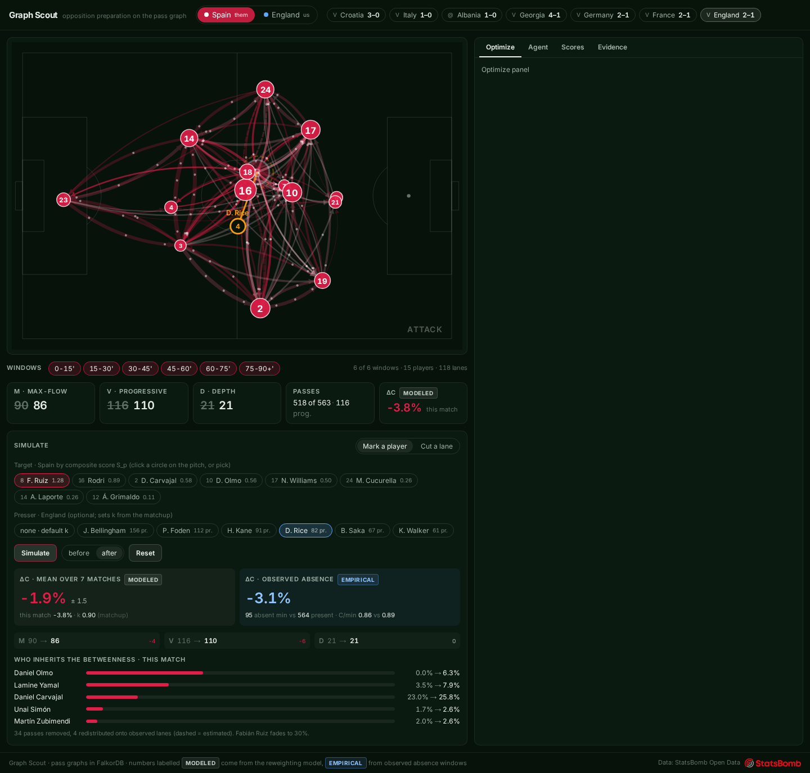
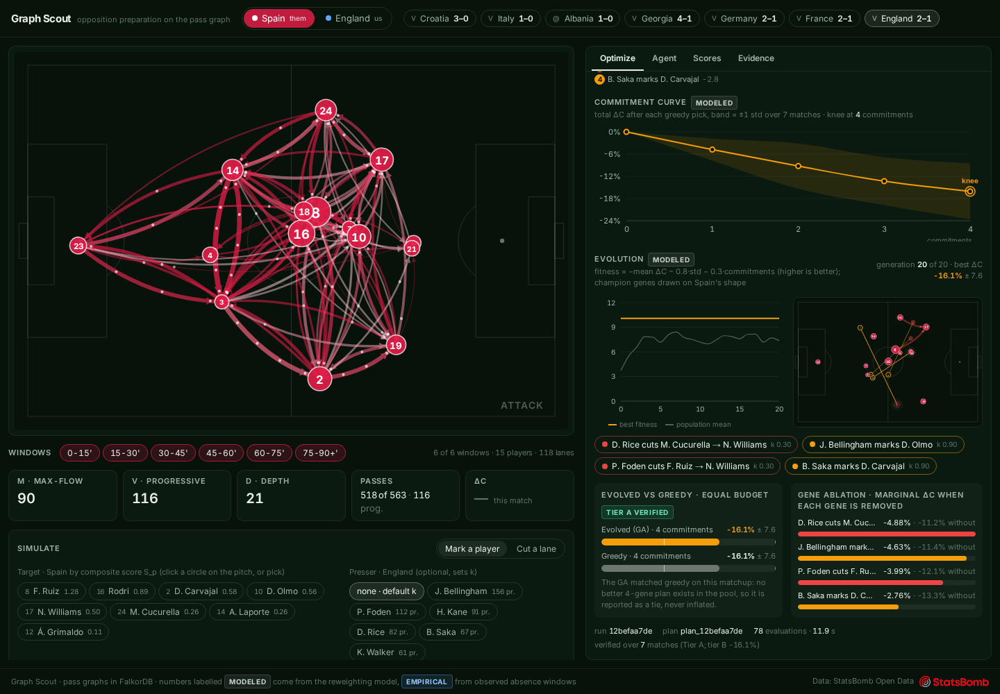
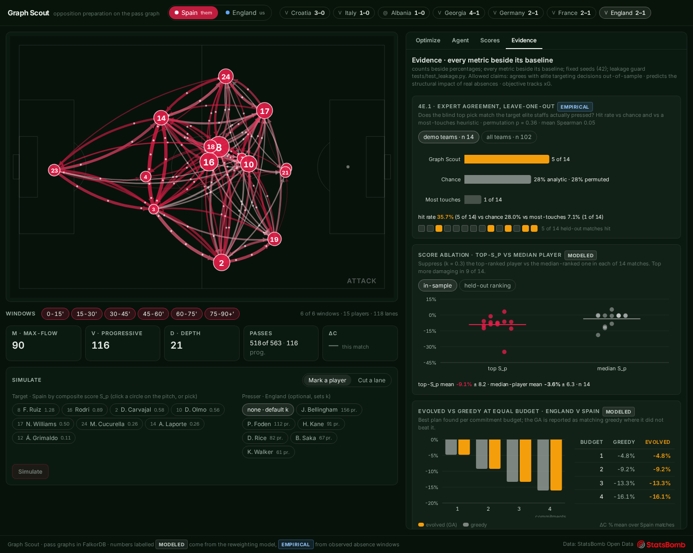
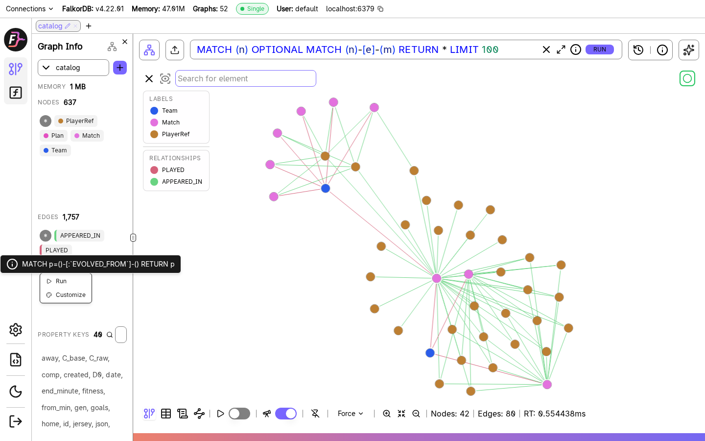
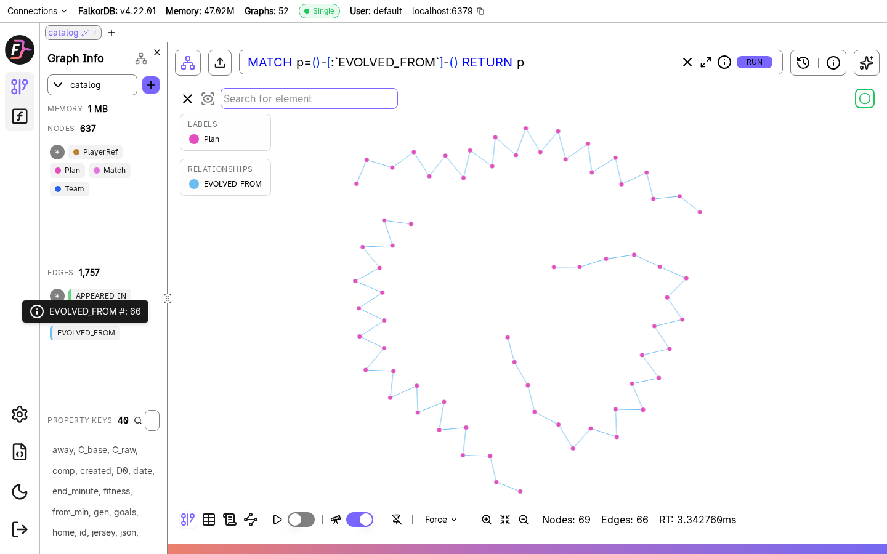
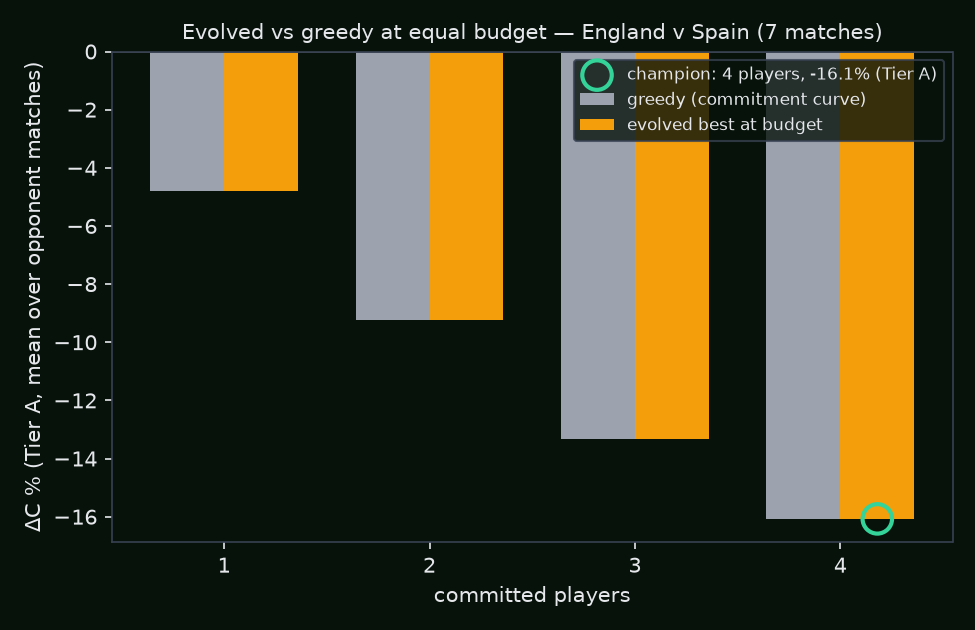
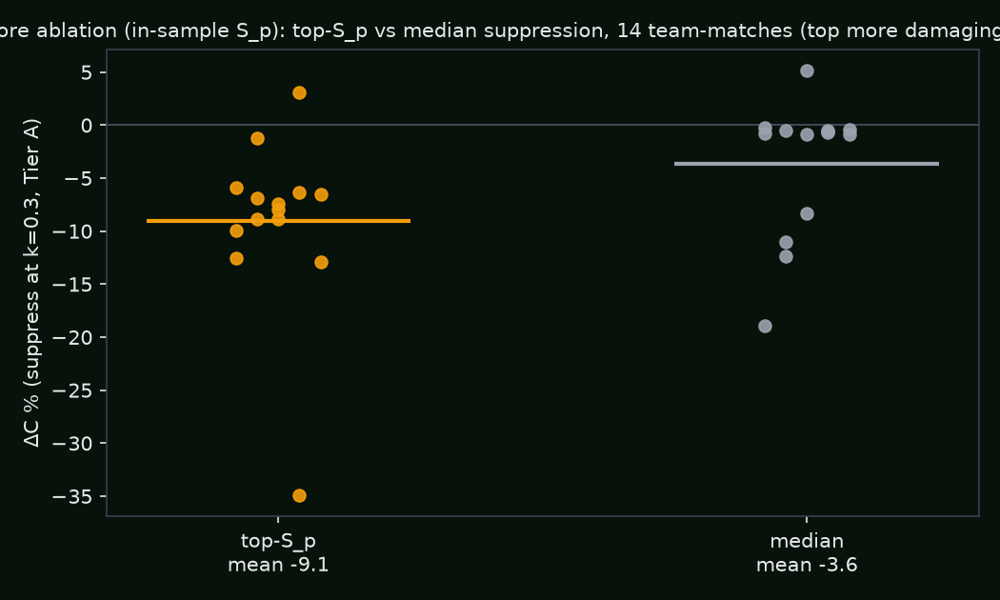
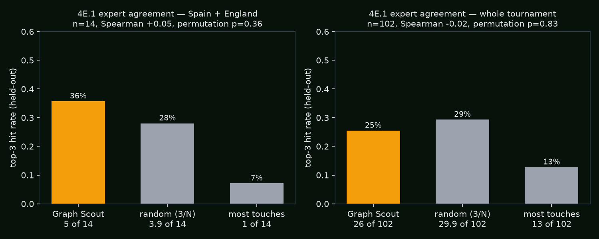
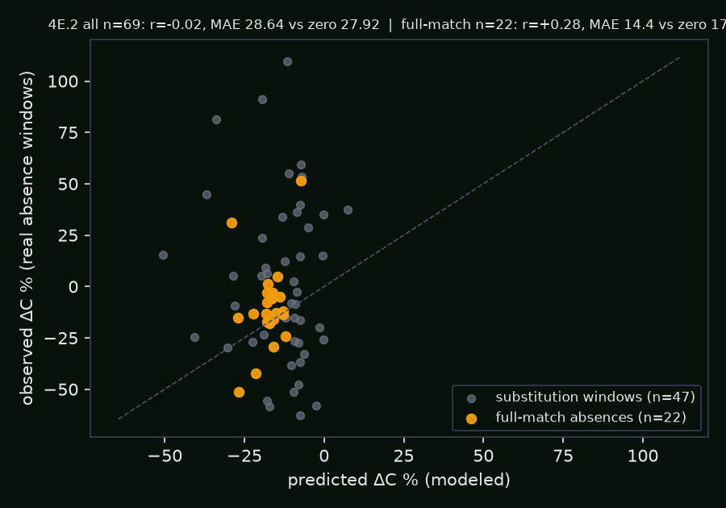
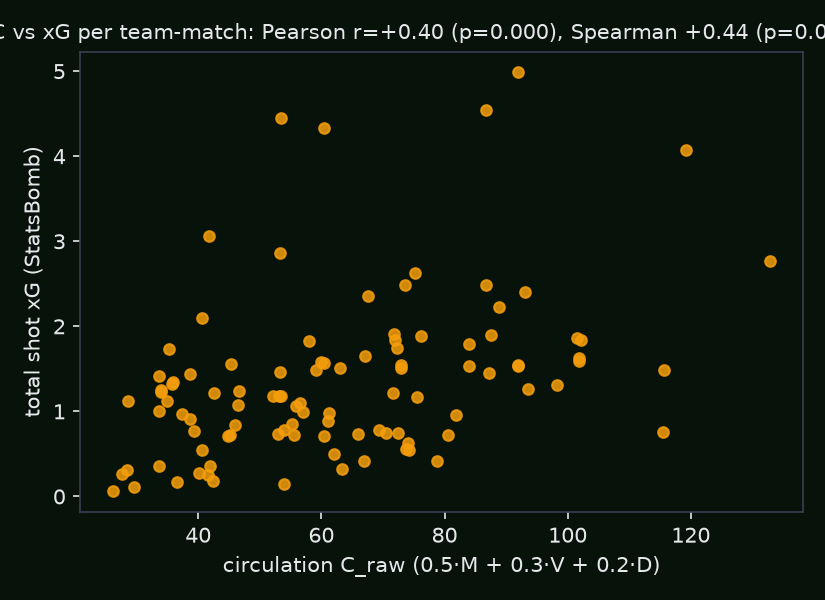

# Graph Scout — counterfactual opposition preparation on FalkorDB

**Graph Hacks (WeMakeDevs × FalkorDB), Track 1: Agents That Act on Connected Data.**

Graph Scout answers the question every opposition analyst is paid for: *who do we take out of their game, and
what happens to their team if we do?* It stores one pass-network graph per match in FalkorDB (52 graphs for
UEFA Euro 2024), runs legal counterfactuals by **cloning and reweighting** those graphs (`GRAPH.COPY`), evolves
the cheapest disruption plan with a **genetic algorithm** over a simulation-evaluated search space (greedy kept
as the measured baseline), and lets a **Claude agent** plan the analysis, call the graph tools, and narrate the
result with every claim pinned to graph evidence.

Demo matchup: **England v Spain** (Euro 2024 final, StatsBomb open data).


Data: [StatsBomb Open Data](https://github.com/statsbomb/open-data) — thank you, StatsBomb/Hudl.

---

## What it does

1. **Ingests** every Euro 2024 match (51) into FalkorDB: one `match_<id>` graph with `:Player` nodes and
   `[:PASS {count, completed, progressive, window}]` edges per (passer, recipient, 15-minute window), plus a
   `catalog` graph (matches, teams, player references, appearances, xG, optimizer lineage).
2. **Scores** every player with a composite structural score S_p from FalkorDB's native PageRank and betweenness
   procedures, progressive involvement, and press resistance.
3. **Simulates** interventions — man-mark (suppress), lane cut, or remove a player — by cloning the match graph
   server-side, reweighting the observed edges, rerouting observed volume, recomputing a team circulation score C,
   diffing, and deleting the clone. Dozens of clones per optimizer run is the intended use of the multigraph.
4. **Optimizes** the plan: a greedy baseline (lock the best cell, re-simulate the remaining matrix with the locked
   interventions applied) and a GA whose champion is verified through the FalkorDB clone pipeline, compared with
   greedy at equal player budget, and explained gene by gene. The evolution history is written back to the catalog
   as a `(:Plan)-[:EVOLVED_FROM]->(:Plan)` chain.
5. **Narrates** through an agent with ten graph tools and a hard 15-call budget; every number in its prose comes from
   a tool output and each claim carries `player:`, `edge:` and `match:` references that light up the pitch.
6. **Evaluates itself** against ground truth from outside the system (real pressing targets, real absences, xG),
   held out, with a baseline beside every number — including the tests it does not pass.

## The app

Left: the pitch canvas (SVG in StatsBomb coordinates, node size = S_p, edge width = completed passes, particles =
volume), the window brush, and the simulate panel with the before→after morph, ΔC ticker (modeled) and the empirical
absence card. Right: Optimize (heatmap with greedy playback, commitment curve, live evolution, evolved-vs-greedy
closing frame with gene ablation), Agent, Scores (weight sliders re-rank live) and Evidence (every chart beside its
baseline). A GSAP landing page at `/` leads into the app at `/app`.





## Why a graph is load-bearing

The questions are multi-hop: *how much ball can still travel from the goalkeeper and centre-backs to the forwards
if this receiver is suppressed and this lane is cut?* That is a **max-flow** over the pass network with completed
passes as capacities, **path diversity** (edge-disjoint source→sink paths), and **progressive volume** — not row
lookups. Centrality (PageRank, betweenness) and community detection are native FalkorDB procedures, and the
counterfactual engine is a graph operation: `GRAPH.COPY` a match, `SET` override properties on the edges, read with
one query that serves both the original and the clone (`coalesce(e.sim_count, e.count)`), delete.

## FalkorDB's role

- **Graph-per-match multigraph.** 51 `match_<id>` graphs + `catalog` in one database (`db.list_graphs()`).
- **GRAPH.COPY counterfactuals.** `g.copy("sim_<uuid>")` → `SET e.sim_count = toInteger(e.count * k)` → read →
  `delete()`; the original never changes. An optimizer run makes ~40 clones; a stale-clone sweep runs at API start.
- **Native algorithms.** `CALL algo.pageRank('Player','PASS')`, `CALL algo.betweenness({nodeLabels:['Player'],
  relationshipTypes:['PASS'], samplingSize:64, samplingSeed:42})`, `CALL algo.labelPropagation({...})` — results
  are cached back onto the nodes (`p.pr_share`, `p.bt_share`, `p.prog_share`).
- **Lineage as a graph.** Open the FalkorDB Browser at http://localhost:3000, select `catalog`, run
  `MATCH (p:Plan)-[r:EVOLVED_FROM]->(q:Plan) RETURN p, r, q` to see the evolution chain of the last GA run.
- **Browser screenshots.** The `catalog` graph (Team, Match, PlayerRef; PLAYED and APPEARED_IN edges) and the GA
  lineage chain (`MATCH p=()-[:EVOLVED_FROM]-() RETURN p`: 69 Plan nodes, 66 edges after three optimizer runs):

  
  

- **Fallback policy** (brief §2.5): what FalkorDB lacks — max-flow with super-source/sink and edge-disjoint paths —
  is computed in networkx from a single edge-list pull, with FalkorDB as the source of truth. Max-flow is networkx in
  *both* simulation tiers so the two cannot drift.

## The no-fiction contract and the full assumptions list

We only **subtract and reweight observed events**. We never invent passes, positions, formations or scorelines.
Every number on screen traces to events or to one of these stated formulas:

| Item | Definition (fixed; constants in `backend/app/metrics/formulas.py`) |
|---|---|
| Pitch / orientation | StatsBomb 120×80; every acting team's events are in its own attacking frame (left→right). |
| Progressive pass | completed AND (`end_x − x ≥ 15` OR (`end_x ≥ 80` AND `end_x − x ≥ 5`)). |
| Zones | 6 columns × 4 rows of 20×20 units, id `c{0..5}r{0..3}`. Presser vs receiver histograms are compared after mirroring one frame (`(c,r) → (5−c, 3−r)`). |
| Windows | `0-15, 15-30, 30-45, 45-60, 60-75, 75-90+` by minute. |
| Edge | one directed edge per (passer, recipient, window) with `count, completed, progressive`. |
| Touches | Pass, Ball Receipt*, Carry, Dribble, Shot, Clearance, Ball Recovery, Interception events. |
| Press resistance | `comp_rate(under_pressure) − comp_rate(all)` from pressured-pass counts summed across the tournament; players with < 15 pressured passes take the team median; min-max to [0,1] within the squad. (Per-match values are also stored on the nodes.) |
| Regain rate | share of a player's Pressure events followed by his team having possession within 5 s in the same period; < 10 pressures → team median. |
| Player score S_p | `0.30·z(PR share) + 0.30·z(BT share) + 0.25·z(ProgInv share) + 0.15·z(press resistance)`, shares within match/team, z-scores among teammates, mean ± std across matches. Weights are UI sliders. |
| Circulation C | completed-pass network; super-source S→{Goalkeeper, *Center Back*}, {*Forward*, *Striker*, *Wing* (not Wing Back)}→super-sink T from lineup positions. `M` = max-flow with capacities = completed counts; `D` = edge-disjoint S→T paths (unit capacities on lanes with ≥ 1 completed pass); `V` = completed progressive passes. `C = 100·(0.5·M/M₀ + 0.3·V/V₀ + 0.2·D/D₀)`; baseline is always 100, simulations report ΔC%. |
| Attenuation k (man-mark) | `k = clamp(1 − regain(X)·overlap(X,Y)·(1 − press_resist(Y)), 0.25, 0.90)`, all edges INTO Y multiplied by k. **Deviation:** with Euro 2024 data the raw product never exceeds ~0.1, so every pair clamps to 0.90 and no matchup can be ranked. `K_MODE="relative"` (default) feeds the same formula squad-relative regain (min-max within the pressing squad) and pool-relative overlap (divided by the best overlap in the presser × target pool); `"raw"` is the literal form and both values are reported per pair. |
| Lane cut | that one edge × `k_lane = 0.30`. One job per presser. |
| Delete (absence) | all edges into and out of the player × 0. |
| Reroute (estimated) | removed completed passes from passer a into Y are redistributed across a's other **observed completed** lanes in the same window whose receiver sits in Y's zone column, proportional to observed counts, floored (redistributed ≤ removed), written as `sim_count/sim_completed` with `sim_est = true` so the UI styles them as estimates. |
| Integer rule | both tiers apply one multiplier per (passer, recipient) pair once per edge row with truncation toward zero (`int()` == Cypher `toInteger`), k rounded to 4 dp — Tier A and Tier B agree exactly (`tests/test_consistency.py`). |

## The optimizer story

**Why a GA fits.** The plan space is discrete and constrained (one job per presser, ≤ 4 commitments), the fitness
is a black-box simulation rather than a formula, and interventions interact non-additively (a lane cut changes which
receiver a suppression still hurts). Greedy's blind spot is exactly those interactions.

- **Candidate pools:** our top-6 pressers (pressures × regain) × their top-4 by S_p (marks) + their top-3 lanes by
  progressive volume (cuts). k is matchup-derived per (presser, target).
- **Two tiers.** Tier A (authoritative): FalkorDB clone → reweight → recompute → diff → delete, used for every number
  shown as verified. Tier B (fast fitness): each opponent match's edge list pulled from FalkorDB once; a plan
  evaluation is array reweighting + max-flow in memory (~2 ms), so a whole evolution runs in ~2 s. **Consistency
  test (required):** 5 random plans × 3 matches, Tier B == Tier A exactly.
- **Greedy baseline:** best feasible cell, lock, re-simulate the remaining matrix with the locked set applied, repeat
  to 4; `force`/`forbid` cells for human-in-the-loop re-solves; commitment curve with the knee.
- **GA:** 4-gene chromosome (`None` or `{presser, mark|cut, target}`), repair drops later duplicate pressers/targets,
  fitness = `−mean ΔC% − 1.5 × committed players` (a lethal two-man plan can beat a mediocre four-man plan),
  uniform crossover p=0.5, mutation p=0.25 per gene (swap presser | retarget | fill | empty), tournament k=3,
  population 30, 20 generations, elitism 2, seeded with greedy's plan and its prefixes so the champion is never worse
  than greedy, fixed seed 42.
- **Verification & explainability:** the champion and greedy-at-equal-budget are re-run through Tier A; each gene is
  removed one at a time (Tier A) to attach its marginal ΔC.

**Result, England v Spain (7 Spain matches, Tier A):** champion = Rice cuts Cucurella→N. Williams, Bellingham marks
Olmo, Foden cuts Fabián Ruiz→N. Williams, Saka marks Carvajal: **ΔC −16.1% ± 7.6**. Gene ablation: the
Cucurella→Williams cut carries −4.9, Olmo mark −4.6, Fabián→Williams cut −4.0, Carvajal mark −2.8. On this matchup
**evolution confirmed greedy's plan** (equal ΔC at every budget 1–4) — reported as such, not inflated.

Reverse matchup, **Spain v England** (7 England matches): N. Williams marks Saka, Yamal marks Foden, Cucurella marks
Walker (k = 0.40 — Walker is England's least press-resistant regular, so the matchup k bites), Morata marks Bellingham:
**ΔC −30.5% ± 20.9**; the GA found a slightly better two-man plan than greedy's prefix (−19.6 vs −19.6) and tied at four.



## Evaluation (held out; every metric beside its baseline)

Reporting rules (brief §4E.4): counts beside percentages, baselines beside every metric, fixed seeds, and a leakage
guard (`tests/test_leakage.py` asserts the fold-m score table contains no rows from match m).

**Score ablation (brief Phase 3, required).** For every demo team-match, ΔC from suppressing the top-S_p player at
k = 0.3 vs the median player: top −9.1 ± 8.2 vs median −3.6 ± 6.3; the top player is more damaging in **9 of 14**
(in-sample S_p; held-out S_p: −9.1 vs −8.0, 8 of 14).



**4E.1 Expert agreement (required).** Leave-one-out: S_p without match m; prediction = top outfield player with
≥ 45 min; ground truth = the opponent's most-pressured-per-touch players in m.

> Blind to the match, the system re-derives the pressing targets elite staffs chose in **5 of 14** held-out
> Spain/England games, against a **28 %** chance rate (random-targeting baseline 3.9 of 14 by 10 000 permutations,
> p = 0.36); the most-touches heuristic manages **1 of 14**. Across all 24 teams it is **26 of 102** against a
> **29 %** chance rate (most-touches: 13 of 102) — i.e. at chance. Mean Spearman between the S_p ranking and the
> pressure-per-touch ranking: +0.05.

Honest reading: structural importance (what S_p measures) and "who gets pressed per touch" (which favours wide
receivers and forwards) are different things; the heuristic coaches demonstrably do *not* use is "press the player
with most touches".



**4E.2 Out-of-sample impact prediction.** Absence events = a team's top-4-by-S_p player (scores without the test
match) missing ≥ 20 minutes of whole 15-minute windows; predicted ΔC from a simulator built only from his other
matches (delete for a full-match absence, suppress k = 0.3 for a substitution); observed ΔC = the team's per-minute
circulation in those windows vs the same window ids of matches where he played.

| subset | n | Pearson r | MAE (ΔC pts) | always-zero MAE | beats zero? |
|---|---|---|---|---|---|
| all absence events | 69 | −0.02 | 28.6 | 27.9 | **no** |
| full-match absences (delete) | 22 | +0.28 | 14.4 | 17.8 | yes |
| substitution windows (suppress) | 47 | −0.09 | 35.3 | 32.7 | no |

The split is pre-specified by the brief (delete vs suppress). Substitution windows are single 15-minute slices where
M and D are small integers (observed SD 40 points) and the counterfactual does not beat the zero forecaster there;
it does on full-match absences, modestly. Claim allowed: *predicts the structural impact of real full-match absences*.



**4E.3 Construct validity.** Per team-match, C_raw (`0.5·M + 0.3·V + 0.2·D`, un-normalised) vs total StatsBomb shot
xG (own goals are separate events, so excluded): **Pearson r = +0.40 (p < 0.001), Spearman +0.44, n = 102**.
Correlation, not causation: reducing C plausibly means reducing chance creation, nothing more.



Allowed claims: "agrees with elite targeting decisions out-of-sample" (only for the demo teams, weakly),
"predicts the structural impact of real absences" (full-match absences), "objective tracks xG".
Forbidden and not made: "better than experts", "predicts match outcomes".

## The agent

Model: Anthropic `claude-sonnet-5-5` through the official `anthropic` SDK (a user-directed deviation from the brief's
Gemma-only policy; the rest of the policy stands: the LLM only plans, selects tools, and writes prose; all numeric
work is Cypher/algorithms; a hard cap of 15 model calls per question is enforced by a counter that aborts loudly).
Tools (each returns data + `refs`): `list_matches`, `team_profile`, `player_scores`, `decompose_influence`,
`pressure_profile`, `empirical_window`, `simulate`, `optimize` (GA default, greedy comparison, gene ablation),
`eval_summary`, `save_plan`. Conversations are multi-turn: the server keeps the full transcript per conversation id,
tool calls and results included, so follow-up questions reuse earlier evidence instead of re-deriving or retracting it.
The answer streams prose and ends with a fenced JSON block
`{claims:[{text, refs, basis:"modeled"|"empirical", value}], plan_id?}`; refs not produced by a tool in that turn are
dropped before the UI highlights them.

## Run it locally

```bash
# 0. FalkorDB (Redis protocol :6379, Browser UI :3000)
docker run -d --name falkordb -p 6379:6379 -p 3000:3000 \
  -v falkordb_data:/var/lib/falkordb/data falkordb/falkordb:latest

# 1. Backend (Python 3.12 via uv; any 3.11+ venv works)
pip install --user uv
cd backend && uv venv --python 3.12 .venv && uv pip install --python .venv/bin/python \
  falkordb pandas numpy networkx fastapi "uvicorn[standard]" sse-starlette anthropic python-dotenv pytest matplotlib scipy requests
.venv/bin/python scripts/smoke.py                 # Phase 0 acceptance (GRAPH.COPY round trip)
.venv/bin/python scripts/ingest.py --whole-tournament   # 51 match graphs + catalog (reads open-data/data/ if cloned, else HTTP + cache)
.venv/bin/python -c "from app.metrics import scores as S; S.build_profiles()"
.venv/bin/python scripts/pagerank_top3.py         # Phase 2 acceptance (native PageRank)
.venv/bin/python -m pytest -q                     # formulas, Tier A/B consistency, leakage guard
.venv/bin/python scripts/ablation.py in_sample && .venv/bin/python scripts/run_evals.py   # charts + eval/summary.json
./run_api.sh                                      # FastAPI on :8000 (CORS open, no auth)

# 2. Agent credential (only needed for the chat): put a key in ./.env (re-read on every question)
echo 'ANTHROPIC_API_KEY=sk-ant-...' > .env
# Key types: a workspace key (sk-ant-api03-...) or a personal key created INSIDE a workspace (sk-ant-usr-...) works
# as-is. A personal key with no workspace scope is valid too but the API answers 400 "not scoped to a workspace";
# then add ANTHROPIC_WORKSPACE_ID=wrkspc_... (Console -> Settings -> Workspaces) and the agent sends the
# anthropic-workspace-id header for you.
backend/.venv/bin/python backend/scripts/chat.py "How do we beat Spain?"

# 3. Frontend (Vite + React + TS + Tailwind; proxies /api -> :8000)
cd frontend && npm install && npm run dev -- --port 5173
```

Data: the pipeline reads `open-data/data/...` from a local clone of StatsBomb open data when present and otherwise
fetches each file from `raw.githubusercontent.com` into `backend/data_cache/` (≈ 250 MB for the tournament). No
StatsBomb account is needed.

## Deploy (FalkorDB Cloud + Render + Vercel)

The app is three pieces. The database cannot run on Render's free tier (it exposes HTTP only), so it goes to
FalkorDB Cloud; the API goes to Render; the static frontend goes to Vercel.

1. **FalkorDB Cloud** — create a free instance at https://app.falkordb.cloud, copy host, port and password.
   Connection URL: `falkors://default:<password>@<host>:<port>` (use `falkor://` if the instance has no TLS).
2. **Load the graphs from your laptop** (the pipeline fetches StatsBomb files over HTTP, no clone needed):
   ```bash
   cd backend && FALKOR_URL='falkors://default:<password>@<host>:<port>' .venv/bin/python scripts/ingest.py --whole-tournament
   FALKOR_URL='falkors://...' .venv/bin/python -c "from app.metrics import scores as S; S.build_profiles()"
   FALKOR_URL='falkors://...' .venv/bin/python -c "from app.evals import xg; xg.run()"   # caches C baselines
   ```
3. **Render** — "New → Blueprint", point it at this repo; `render.yaml` defines the `graph-scout-api` web service
   (Python 3.12, `pip install -r backend/requirements.txt`, uvicorn on `$PORT`, health check `/api/health`).
   Set `FALKOR_URL` and `ANTHROPIC_API_KEY` in the service's environment. The free plan sleeps after 15 idle
   minutes; the first request after that takes ~30 s. `eval/summary.json` is committed, so `/api/eval` works
   without rerunning the evaluations.
4. **Vercel** — import the repo, root directory `frontend`, framework Vite, build `npm run build`, output `dist`.
   Set `VITE_API_BASE=https://<your-render-service>.onrender.com`. `frontend/vercel.json` rewrites every route to
   `index.html` so `/` (landing) and `/app` both load. SSE streams (optimize, chat) go straight from the browser to
   Render, which keeps them unbuffered.

## Repository map

```
BUILD_BRIEF.md  PROGRESS.md (dated build log, deviations)  VIDEO.md (shot list)  CLAUDE.md  .claude/skills/scout-viz
backend/app/ingest      statsbomb.py (loader + parser), load.py (UNWIND writes, catalog)
backend/app/graph       cypher.py (every Cypher string), db.py (reads, native CALLs, fallbacks, sim sweep)
backend/app/metrics     formulas.py, circulation.py (C), scores.py (S_p, profiles, k)
backend/app/sim         model.py (the one reweighting rule), tier_a.py, tier_b.py, empirical.py, engine.py
backend/app/optim       candidates.py, greedy.py, ga.py, run.py (SSE stream, verification, lineage)
backend/app/evals       expert.py (4E.1), absence.py (4E.2), xg.py (4E.3)
backend/app/agent       tools.py, loop.py          backend/app/api/main.py (FastAPI)
backend/tests           test_formulas, test_consistency, test_leakage   backend/eval (charts, summary.json)
frontend/src            store.ts, api.ts, components/ (PitchCanvas, WindowBrush, SimDiff, AssignmentHeatmap,
                        CommitmentCurve, EvolutionView, AgentPanel, WeightSliders, EvidencePanel)
```

## Credits

- Data: [StatsBomb Open Data](https://github.com/statsbomb/open-data) (Hudl StatsBomb) — see their licence.
- Database: [FalkorDB](https://www.falkordb.com) — graph-per-match multigraph, `GRAPH.COPY`, native algorithms.
- Event: Graph Hacks by WeMakeDevs × FalkorDB.
- Built with Claude Code; the agent runs on Anthropic Claude Sonnet 5.5.
